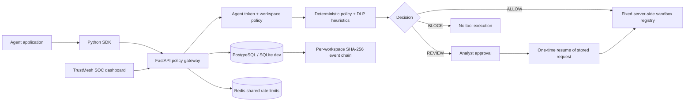

# TrustMesh

TrustMesh checks an AI agent's identity and permissions before it can use a registered tool. Safe demo requests run in the gateway; unauthorized requests are blocked, and higher-risk requests wait for a reviewer. Each decision and execution outcome is recorded in a workspace-scoped audit chain.

TrustMesh is an **engineering MVP for a controlled pilot and placement demo**. It has real API, persistence, identity, workspace isolation, browser UI, an SDK interception boundary, PostgreSQL/Redis deployment configuration, and automated tests. It is not a certified product or an independently security-reviewed production service. The rule engine is heuristic; no LLM or trained ML detector is included in this build.

## Architecture and data flow



The SDK's `execute_tool` calls a server-side, fixed registry. The server derives action/resource from the selected tool, runs policy, and alone controls execution. REVIEW stores the exact arguments; `resume_tool` accepts no replacement parameters, and runs only after an analyst's unexpired, one-time approval. `POST /v1/actions/evaluate` is only a policy preview and never grants permission to execute. The included tools use fictional in-process data; a real deployment must integrate its actual tools behind the same server-enforced gateway and handle external side effects with a durable transactional outbox/idempotency scheme.

## Local setup (Windows PowerShell)

From the extracted `trustmesh` directory:

```powershell
py -3 -m venv .venv
.\.venv\Scripts\Activate.ps1
python -m pip install -r requirements-dev.txt
$env:TRUSTMESH_ENV = "dev"
$env:TRUSTMESH_ADMIN_KEY = "dev-key"
$env:TRUSTMESH_DATABASE_URL = "sqlite:///./trustmesh.db"
$env:TRUSTMESH_BOOTSTRAP_EMAIL = "admin@local.test"
$env:TRUSTMESH_BOOTSTRAP_PASSWORD = "ChangeThis-Local-Password-42"
alembic upgrade head
python bootstrap_admin.py
uvicorn app:app --reload
```

The bootstrap password above is an example: replace it with a unique local value. Do not use it for a deployed service. `alembic upgrade head` initializes the SQLite schema; the app also creates missing tables in local dev mode for convenience.

Open the dashboard at [http://127.0.0.1:8000/](http://127.0.0.1:8000/). In dev, the dashboard accepts `dev-key`; use **Sign in** for a provisioned user. Swagger is at `/docs`, ReDoc at `/redoc`, liveness at `/healthz`, readiness at `/readyz`, and metrics at `/metrics`.

### Run it from VS Code

Open the `trustmesh` folder. After creating `.venv` and installing `requirements-dev.txt`, use **Terminal → Run Task → TrustMesh: Run API**. It migrates a separate local workspace database and starts Uvicorn on port 8000. Choose **TrustMesh: Run tests** for the test suite or **TrustMesh: Evaluate sample rules** for the small labeled fixture. **TrustMesh: Docker Compose** starts the PostgreSQL/Redis stack when Docker Desktop is running.

## Docker Compose

For an isolated local stack, copy `.env.example` to `.env`, change the Postgres password, and run:

```powershell
Copy-Item .env.example .env
docker compose up --build
```

Compose starts the API, PostgreSQL and Redis on a private service network; only the API port is published. Migrations run before the API starts. The default Compose profile is for local demonstration. For production-like configuration, set `TRUSTMESH_ENV=production`, `TRUSTMESH_DOCS=false`, a random `TRUSTMESH_ADMIN_KEY`, independent random `TRUSTMESH_TOKEN_SECRET` and `TRUSTMESH_DATA_KEY` values (32+ characters each), strong database credentials, bootstrap admin credentials, and the actual CORS origins before startup. Production mode rejects SQLite and missing Redis configuration. Put TLS at a trusted reverse proxy and use a secret manager; do not publish Postgres or Redis ports.

## Deploy to Render

The repository includes a Render Blueprint for a portfolio/demo deployment with the web service, PostgreSQL, and Redis-compatible Key Value service. See [DEPLOY.md](DEPLOY.md) for setup steps, required first-admin secrets, and free-tier limits. The Blueprint deliberately uses free plans; review the host's current limits and costs before applying it. Do not use the free demo deployment for real customer or sensitive data.

## Reproducible demo

1. Sign in as the provisioned workspace admin.
2. Register an agent with `read`, `send` and `export` permissions. Copy the one-time token.
3. In PowerShell, run `$env:TRUSTMESH_AGENT_TOKEN = "tm_..."; python demo_agent.py`. The safe in-process sandbox has fixed fictional document/customer records and no shell, arbitrary SQL, filesystem writes, or uncontrolled network tools.
4. The Attack Lab simulates prompt injection, credential exfiltration, privilege escalation, and a sensitive export. The Lab is disabled outside local dev.
5. The email and invoice actions are REVIEW. Approve one in the queue, then run `$env:TRUSTMESH_AGENT_TOKEN = "tm_..."; python resume_demo.py <event_id>` using its printed event ID. The server executes its stored request once.
6. Verify the audit chain. Edit a stored event in a test DB to see verification fail.

## API and access control

| Endpoint | Access | Purpose |
|---|---|---|
| `POST /v1/auth/login` | Public, rate-limited | Email/password login; returns a 15-minute access token |
| `POST /v1/auth/logout` | User token | Revoke the current access session |
| `POST /v1/users` | Workspace admin | Provision a workspace member with Admin, Analyst, Developer or Auditor role |
| `POST /v1/users/{id}/disable` | Workspace admin | Disable a member; their token is rejected on its next request |
| `POST /v1/agents` | Workspace admin | Create an agent and issue a one-time 90-day credential |
| `GET /v1/agents` | Workspace member | List agents in the authenticated workspace only |
| `POST /v1/agents/{id}/disable` | Workspace admin | Revoke agent credential |
| `POST /v1/agents/{id}/rotate` | Workspace admin | Rotate a credential; old token stops working |
| `POST /v1/actions/evaluate` | Agent Bearer token | Policy preview only; does not authorize external execution |
| `POST /v1/tools/{tool}/execute` | Agent Bearer token | Evaluate and execute a fixed server-side sandbox tool; idempotent per key |
| `POST /v1/actions/{event_id}/resume` | Same agent token | Execute the exact stored request after approval, at most once |
| `GET /v1/overview` | Admin, Analyst, Developer, Auditor | Tenant-scoped dashboard data |
| `POST /v1/approvals/{event_id}?decision=ALLOW` | Admin or Analyst | Approve/block a pending gateway action |
| `GET /v1/audit/verify` | Workspace member | Verify the workspace hash chain |
| `POST /v1/lab/{scenario}` | Local dev only | Run a safe policy simulation |

Human passwords use scrypt hashes; user tokens are HMAC signed, 15-minute, and backed by revocable server-side sessions. Agent tokens are random, stored only as SHA-256 hashes, expire after 90 days and can be rotated/revoked. Gateway arguments, derived payloads and results are AES-GCM encrypted at rest with `TRUSTMESH_DATA_KEY`; rotate this key only with an explicit data re-encryption/migration plan. Workspaces scope agents, action events, approvals and audit views. Dev's shared `dev-key` is an explicit local-only shortcut; production disables it and uses user sessions. Bootstrap the first workspace admin using `TRUSTMESH_BOOTSTRAP_EMAIL` and `TRUSTMESH_BOOTSTRAP_PASSWORD` through the included script.

## Tests and measured behavior

```powershell
python -m pip install -r requirements-dev.txt
pytest -q
python evaluate_dataset.py
```

The tests use an isolated in-memory SQLite database and cover API startup, policy decisions, server-side allow/block/review, stored-request approval/resumption, idempotent retries, audit tampering, DLP/Luhn checks, role checks, logout revocation, and cross-tenant read/IDOR attempts. The labeled CSV is a tiny hand-written smoke fixture. Its metrics are not a representative estimate of real-world performance. No ML model is trained or loaded, so there is no ML accuracy claim.

## Configuration

| Variable | Purpose |
|---|---|
| `TRUSTMESH_ENV` | `dev` enables local key shortcut, docs and Attack Lab; `production` turns those off |
| `TRUSTMESH_ADMIN_KEY` | Required strong secret in production; only accepted as an auth method in dev |
| `TRUSTMESH_TOKEN_SECRET` | HMAC signing key, at least 32 random characters in production |
| `TRUSTMESH_DATA_KEY` | Independent encryption key for persisted gateway data, at least 32 random characters in production |
| `TRUSTMESH_DATABASE_URL` | SQLite in dev or PostgreSQL in production |
| `TRUSTMESH_REDIS_URL` | Required in production for shared rate limiting; Redis outage fails closed on API calls |
| `TRUSTMESH_DOCS` | Show API documentation only when explicitly enabled |
| `TRUSTMESH_CORS_ORIGINS` | Comma-separated browser origins; never use `*` for a deployment |
| `TRUSTMESH_RATE_LIMIT_PER_MIN` | Per-client/API-group fixed-window limit (default 120/minute) |
| `TRUSTMESH_REVIEW_THRESHOLD` | Deterministic review risk threshold (default 35) |
| `TRUSTMESH_BLOCK_THRESHOLD` | Deterministic block risk threshold (default 70) |
| `TRUSTMESH_BOOTSTRAP_EMAIL/PASSWORD` | Initial admin provisioning only; provide through a secret manager |

## Current security boundaries and gaps

- Risk scores are heuristic severity points, **not** calibrated attack probabilities. The registered demo tools cannot be invoked through the gateway without its policy decision. Generic policy preview does not control a caller's independent external tools; only integrations whose actual dispatch is placed behind a server-side gateway receive enforcement.
- Prompt-injection and DLP detection use deterministic patterns. They are bypassable and can create false positives. Payment-card detection checks Luhn; it does not establish card ownership or classify all regulated data.
- The project does not include an LLM provider, semantic intent analysis, trained Isolation Forest, or production ML pipeline. This is an explicit gap rather than a mocked “AI” result.
- There is no OIDC/SSO, MFA, refresh-token flow, organization membership across multiple workspaces, per-tenant policy editor, tenant provisioning UX, persistent user audit identity for shared dev-key operations, external signed audit anchoring, SIEM integration, backup automation, or formal key/secret rotation schedule. The fixed demo registry is not a production tool integration or durable action queue.
- Redis rate limits are shared in Docker Compose. SQLite/dev limits are process-local. Multi-worker production use depends on Redis being available.
- Audit chaining detects individual record edits/reordering. A database administrator who can rewrite all rows can recompute the chain; export signed checkpoints to independent storage for stronger evidence.
- No security certification, penetration-test completion, SOC 2/ISO status, production incident history, or customer deployment is claimed. A real pilot needs TLS, secrets management, backups/restore drills, retention/privacy review, external audit export, alerting, load and failure testing, and an independent security review.

See [THREAT_MODEL.md](THREAT_MODEL.md) for assets, attacker assumptions, controls and remaining gaps.
